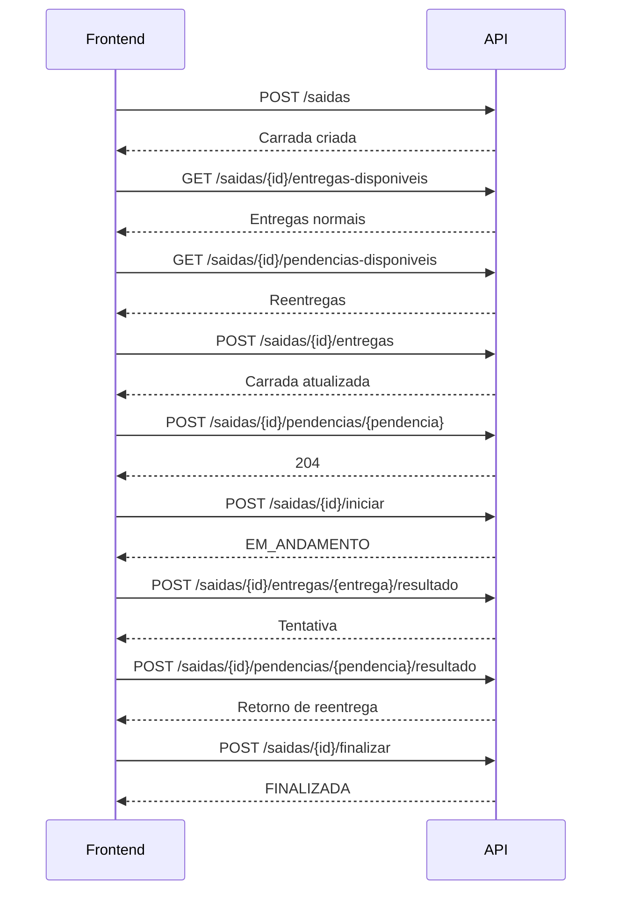

# Endpoints da API

## 1. Objetivo

Este documento registra os endpoints atuais da API do Sistema de Gerenciamento de Entregas.

Base local utilizada no ambiente atual:

```text
http://127.0.0.1:8001
```

Prefixo das rotas:

```text
/api
```

Exemplo:

```text
GET http://127.0.0.1:8001/api/saidas
```

---

# 2. Autenticação

As rotas operacionais abaixo estão dentro de:

```php
Route::middleware('auth:sanctum')
```

Portanto, exigem sessão autenticada pelo Laravel Sanctum.

---

# 3. Formato geral

Respostas de recursos normalmente seguem:

```json
{
  "data": {}
}
```

Listagens paginadas podem incluir:

```json
{
  "data": [],
  "links": {},
  "meta": {}
}
```

Erros de validação seguem o padrão do Laravel.

---

# 4. Usuário autenticado

## `GET /api/user`

Retorna o usuário autenticado.

### Resposta

```json
{
  "id": 1,
  "name": "Administrador",
  "email": "admin@sistema.com"
}
```

Os campos adicionais dependem do Model `User`.

---

# 5. Regiões

As rotas são geradas por:

```php
Route::apiResource('regioes', RegiaoController::class)
```

> Observação: a URL utiliza `regioes`, enquanto a tabela física atual é `regiaos`.

| Método | Endpoint | Objetivo |
|---|---|---|
| GET | `/api/regioes` | Listar regiões |
| POST | `/api/regioes` | Criar região |
| GET | `/api/regioes/{regiao}` | Buscar região |
| PUT/PATCH | `/api/regioes/{regiao}` | Atualizar região |
| DELETE | `/api/regioes/{regiao}` | Remover/desativar conforme regra do controller |

---

# 6. Clientes

As rotas são geradas por:

```php
Route::apiResource('clientes', ClienteController::class)
```

| Método | Endpoint | Objetivo |
|---|---|---|
| GET | `/api/clientes` | Listar/pesquisar clientes |
| POST | `/api/clientes` | Criar cliente |
| GET | `/api/clientes/{cliente}` | Buscar cliente |
| PUT/PATCH | `/api/clientes/{cliente}` | Atualizar cliente |
| DELETE | `/api/clientes/{cliente}` | Remover/desativar conforme regra |

---

# 7. Entregas

As rotas básicas são geradas por:

```php
Route::apiResource('entregas', EntregaController::class)
```

| Método | Endpoint | Objetivo |
|---|---|---|
| GET | `/api/entregas` | Listar entregas |
| POST | `/api/entregas` | Criar entrega |
| GET | `/api/entregas/{entrega}` | Buscar entrega |
| PUT/PATCH | `/api/entregas/{entrega}` | Atualizar entrega |
| DELETE | `/api/entregas/{entrega}` | Cancelar/remover conforme implementação |

A listagem pode utilizar filtros definidos pelo `EntregaController`, como status, região, prioridade e busca.

---

# 8. Veículos

As rotas são geradas por:

```php
Route::apiResource('veiculos', VeiculoController::class)
```

| Método | Endpoint | Objetivo |
|---|---|---|
| GET | `/api/veiculos` | Listar veículos |
| POST | `/api/veiculos` | Criar veículo |
| GET | `/api/veiculos/{veiculo}` | Buscar veículo |
| PUT/PATCH | `/api/veiculos/{veiculo}` | Atualizar veículo |
| DELETE | `/api/veiculos/{veiculo}` | Remover/desativar conforme regra |

---

# 9. Carradas — listagem

## `GET /api/saidas`

Lista carradas de forma paginada.

### Query parameters conhecidos

```text
busca
status
data
page
```

### Busca por carrada

O campo `busca` aceita texto contendo o número.

Exemplos:

```text
35
#35
Carrada 35
```

### Exemplo

```text
GET /api/saidas?status=PLANEJADA&page=1
```

ou:

```text
GET /api/saidas?busca=%2335
```

---

# 10. Criar carrada

## `POST /api/saidas`

Cria uma nova carrada.

### Payload

```json
{
  "data_saida": "2026-08-14",
  "regiao_principal_id": 1,
  "veiculo_id": 2,
  "rota": [
    {
      "regiao_id": 1,
      "nome": "Gameleira"
    },
    {
      "regiao_id": 2,
      "nome": "Serra de São João"
    },
    {
      "regiao_id": null,
      "nome": "Banco de Areia"
    }
  ],
  "observacao": null
}
```

### Regras de validação atuais

`data_saida`:

```text
required
date
```

`regiao_principal_id`:

```text
nullable
exists:regiaos,id
```

`veiculo_id`:

```text
nullable
exists:veiculos,id
```

`rota`:

```text
nullable
array
máximo de 30 paradas
```

`rota.*.regiao_id`:

```text
nullable
exists:regiaos,id
```

`rota.*.nome`:

```text
string
máximo 150 caracteres
```

`observacao`:

```text
nullable
máximo 2000 caracteres
```

---

# 11. Buscar carrada

## `GET /api/saidas/{saida}`

Retorna os dados de uma carrada.

Inclui informações carregadas pelo backend como:

- região principal;
- veículo;
- entregas normais;
- itens programados;
- equipe;
- pendências.

---

# 12. Entregas normais disponíveis pela rota

## `GET /api/saidas/{saida}/entregas-disponiveis`

Retorna entregas que podem ser adicionadas à carrada considerando **todas as regiões cadastradas na rota**.

### Regras

São consideradas entregas nos estados:

```text
PENDENTE
PROGRAMADA
PARCIAL
NAO_ENTREGUE
```

Além disso:

- a região da entrega precisa estar na rota;
- entregas já presentes na carrada são excluídas;
- a entrega precisa possuir pelo menos um item com saldo normal disponível;
- uma entrega `PARCIAL` que possui somente pendência não aparece aqui;
- a ordenação segue a ordem das regiões na rota.

### Resposta simplificada

```json
{
  "data": [
    {
      "id": 10,
      "numero_pedido": "89567",
      "cliente_nome": "João",
      "endereco": "Rua A",
      "regiao_id": 2,
      "regiao_nome": "Serra de São João",
      "status": "PENDENTE",
      "prioridade": "NORMAL"
    }
  ]
}
```

---

# 13. Itens disponíveis de uma entrega

## `GET /api/planejamento/entregas/{entrega}/itens-disponiveis`

Retorna os produtos e seus saldos disponíveis para programação em carrada.

### Resposta

```json
{
  "data": {
    "entrega_id": 10,
    "numero_pedido": "89567",
    "cliente_nome": "João",
    "endereco": "Rua A",
    "itens": [
      {
        "entrega_item_id": 20,
        "codigo_produto": "148",
        "descricao_produto": "Argamassa AC3",
        "unidade": "UN",
        "quantidade_solicitada": 50,
        "quantidade_disponivel": 45
      }
    ]
  }
}
```

### Observação

`quantidade_disponivel` não significa simplesmente:

```text
solicitado - entregue
```

O cálculo também considera:

- devoluções;
- pendências ativas;
- reservas em carradas.

---

# 14. Adicionar entrega à carrada

## `POST /api/saidas/{saida}/entregas`

Adiciona uma entrega normal à carrada.

### Payload conceitual

```json
{
  "entrega_id": 10,
  "ordem": 1,
  "itens": [
    {
      "entrega_item_id": 20,
      "quantidade_programada": 30
    }
  ]
}
```

`ordem` é opcional.

A lista `itens` permite programação parcial.

### Regras principais

- carrada precisa estar `PLANEJADA`;
- entrega não pode estar em estado final incompatível;
- produto precisa pertencer à entrega;
- quantidade precisa ser maior que zero;
- quantidade não pode superar o saldo disponível.

---

# 15. Remover entrega da carrada

## `DELETE /api/saidas/{saida}/entregas/{entrega}`

Remove uma entrega normal de uma carrada.

### Regra

A remoção só é permitida enquanto a carrada estiver:

```text
PLANEJADA
```

---

# 16. Pendências disponíveis pela rota

## `GET /api/saidas/{saida}/pendencias-disponiveis`

Lista pendências `ABERTA` que podem ser programadas como reentrega.

### Regras

- entrega precisa pertencer a região cadastrada na rota;
- pendência precisa possuir saldo maior que zero;
- pendência precisa estar `ABERTA`;
- pendência já adicionada à carrada atual não aparece na lista;
- a ordenação segue a rota.

### Resposta simplificada

```json
{
  "data": [
    {
      "id": 1,
      "entrega_id": 10,
      "entrega_item_id": 20,
      "numero_pedido": "89567",
      "cliente_nome": "Doquinha de cicero",
      "endereco": "Serra de São João",
      "regiao_id": 2,
      "regiao_nome": "Serra de São João",
      "codigo_produto": "148",
      "descricao_produto": "Argamassa AC3",
      "unidade": "UN",
      "quantidade_original": 5,
      "quantidade_resolvida": 0,
      "saldo_pendente": 5,
      "status": "ABERTA"
    }
  ]
}
```

---

# 17. Pendências da carrada

## `GET /api/saidas/{saida}/pendencias`

Retorna as reentregas já vinculadas à carrada.

A resposta inclui também dados do resultado quando já houver retorno registrado.

Campos utilizados no frontend incluem:

```text
resultado_registrado
resultado_id
quantidade_programada_resultado
quantidade_entregue_resultado
quantidade_devolvida_resultado
quantidade_reentrega_resultado
destino_restante
motivo_devolucao
observacao_resultado
data_hora_resultado
```

---

# 18. Adicionar pendência à carrada

## `POST /api/saidas/{saida}/pendencias/{pendencia}`

Programa uma pendência como reentrega na carrada.

### Resposta

```text
204 No Content
```

### Regras principais

- carrada deve estar `PLANEJADA`;
- pendência precisa possuir saldo;
- pendência resolvida/cancelada não pode ser usada;
- a mesma pendência não pode ser programada simultaneamente em duas carradas.

Após a operação:

```text
ABERTA → PROGRAMADA
```

---

# 19. Remover pendência da carrada

## `DELETE /api/saidas/{saida}/pendencias/{pendencia}`

Remove uma reentrega de uma carrada planejada.

### Resposta

```text
204 No Content
```

### Resultado

```text
PROGRAMADA → ABERTA
```

---

# 20. Iniciar carrada

## `POST /api/saidas/{saida}/iniciar`

Inicia a operação física da carrada.

### Estado

```text
PLANEJADA → EM_ANDAMENTO
```

### Regra principal

A carrada precisa possuir conteúdo operacional.

Isso pode ser:

- entrega normal;
- reentrega.

---

# 21. Registrar retorno de entrega normal

## `POST /api/saidas/{saida}/entregas/{entrega}/resultado`

Registra o que realmente aconteceu com os produtos daquela entrega.

### Payload

```json
{
  "itens": [
    {
      "entrega_item_id": 20,
      "quantidade_entregue": 45,
      "destino_nao_entregue": "REENTREGA",
      "motivo_devolucao": null,
      "observacao": null
    },
    {
      "entrega_item_id": 21,
      "quantidade_entregue": 18,
      "destino_nao_entregue": "DEVOLVIDO",
      "motivo_devolucao": "CLIENTE_RECUSOU",
      "observacao": "Cliente não quis receber as duas unidades."
    }
  ],
  "motivo_nao_entrega": null,
  "observacao": null
}
```

### `destino_nao_entregue`

Valores aceitos:

```text
REENTREGA
DEVOLVIDO
```

Só é necessário quando existir diferença não entregue.

### `motivo_devolucao`

Valores aceitos:

```text
CLIENTE_RECUSOU
CLIENTE_DESISTIU
PRODUTO_INCORRETO
PRODUTO_AVARIADO
QUANTIDADE_EXCEDENTE
OUTRO
```

### Regras principais

- carrada deve estar `EM_ANDAMENTO`;
- entrega precisa pertencer à carrada;
- retorno não pode ser registrado duas vezes para a mesma entrega/carrada;
- quantidade entregue não pode ser negativa;
- quantidade entregue não pode ultrapassar carregado;
- item informado precisa estar programado.

### Resultado

Dependendo do destino:

```text
REENTREGA
→ cria pendência
```

ou:

```text
DEVOLVIDO
→ registra devolução
→ não cria pendência
```

### Resposta

```http
201 Created
```

Exemplo:

```json
{
  "data": {
    "id": 50,
    "entrega_id": 10,
    "saida_id": 35,
    "resultado": "PARCIAL",
    "motivo_nao_entrega": null,
    "observacao": null,
    "data_hora": "2026-08-14T23:00:00Z",
    "itens": [
      {
        "id": 70,
        "entrega_item_id": 20,
        "quantidade_entregue": 45,
        "observacao": null
      }
    ]
  }
}
```

---

# 22. Registrar retorno de reentrega

## `POST /api/saidas/{saida}/pendencias/{pendencia}/resultado`

Registra o resultado da pendência que foi levada naquela carrada.

### Payload — reentrega completa

```json
{
  "quantidade_entregue": 5,
  "destino_restante": null,
  "motivo_devolucao": null,
  "observacao": null
}
```

### Payload — reentrega parcial que continuará

```json
{
  "quantidade_entregue": 3,
  "destino_restante": "REENTREGA",
  "motivo_devolucao": null,
  "observacao": null
}
```

### Payload — reentrega parcial com devolução

```json
{
  "quantidade_entregue": 3,
  "destino_restante": "DEVOLVIDO",
  "motivo_devolucao": "CLIENTE_DESISTIU",
  "observacao": "Cliente não deseja mais as duas unidades restantes."
}
```

### `destino_restante`

Valores:

```text
REENTREGA
DEVOLVIDO
```

### Regras

- carrada precisa estar no estado operacional permitido pelo Service;
- pendência precisa pertencer à carrada;
- quantidade entregue não pode ultrapassar a quantidade programada da reentrega;
- se restar quantidade, o destino precisa ser definido;
- `DEVOLVIDO` registra uma devolução;
- `REENTREGA` deixa o saldo novamente disponível como pendência.

### Resposta

```http
201 Created
```

Exemplo:

```json
{
  "data": {
    "id": 12,
    "saida_id": 35,
    "pendencia_id": 1,
    "quantidade_programada": 5,
    "quantidade_entregue": 3,
    "quantidade_devolvida": 0,
    "quantidade_reentrega": 2,
    "destino_restante": "REENTREGA",
    "motivo_devolucao": null,
    "observacao": null,
    "data_hora": "2026-08-14T23:00:00Z"
  }
}
```

---

# 23. Finalizar carrada

## `POST /api/saidas/{saida}/finalizar`

Finaliza uma carrada em andamento.

### Regra crítica

Todos os retornos obrigatórios precisam ter sido registrados.

Isso inclui:

```text
entregas normais
+
reentregas
```

Se existir qualquer operação sem retorno, a finalização deve ser bloqueada.

### Estado

```text
EM_ANDAMENTO → FINALIZADA
```

---

# 24. Cancelar carrada

## `POST /api/saidas/{saida}/cancelar`

Cancela uma carrada quando permitido pela regra de negócio.

### Resposta

```text
204 No Content
```

Operações já registradas precisam ser preservadas conforme as proteções do Service.

---

# 25. Histórico da entrega

## `GET /api/entregas/{entrega}/historico`

Retorna a visão histórica e quantitativa de uma entrega.

O histórico é utilizado para exibir informações como:

```text
Comprado
Entregue
Devolvido
Saldo restante
Pendência
Em carrada
Ainda não enviado
```

Também pode incluir tentativas e movimentações relacionadas.

---

# 26. Histórico da carrada

## `GET /api/saidas/{saida}/historico`

Retorna o histórico operacional completo da carrada.

### Estrutura principal

```json
{
  "data": {
    "saida": {},
    "resumo": {},
    "entregas": [],
    "reentregas": [],
    "eventos": []
  }
}
```

### Resumo atual

Campos previstos no contrato TypeScript:

```text
total_entregas
total_entregas_normais
total_reentregas
total_atendimentos
completas
parciais
nao_entregues
sem_resultado
sem_resultado_entregas
sem_resultado_reentregas
quantidade_pendencias_geradas
quantidade_reentrega_programada
quantidade_entregue_reentrega
quantidade_devolvida
```

### Regra

Uma carrada contendo somente reentregas deve retornar:

```text
total_entregas_normais = 0
total_reentregas > 0
total_atendimentos > 0
```

Ela não deve ser considerada uma carrada vazia.

---

# 27. Estados utilizados pela API

## Entrega

```text
PENDENTE
PROGRAMADA
EM_SAIDA
PARCIAL
CONCLUIDA
NAO_ENTREGUE
CANCELADA
```

## Carrada

```text
PLANEJADA
EM_ANDAMENTO
FINALIZADA
CANCELADA
```

## Pendência

```text
ABERTA
PROGRAMADA
RESOLVIDA
CANCELADA
```

## Resultado de tentativa

```text
COMPLETA
PARCIAL
NAO_ENTREGUE
```

## Destino de quantidade não entregue

```text
REENTREGA
DEVOLVIDO
```

---

# 28. Motivos de devolução

Códigos utilizados no contrato HTTP:

| Código | Exibição sugerida |
|---|---|
| `CLIENTE_RECUSOU` | Cliente recusou |
| `CLIENTE_DESISTIU` | Cliente desistiu |
| `PRODUTO_INCORRETO` | Produto incorreto |
| `PRODUTO_AVARIADO` | Produto avariado |
| `QUANTIDADE_EXCEDENTE` | Quantidade excedente |
| `OUTRO` | Outro |

---

# 29. Fluxo principal pela API



---

# 30. Regras para novos endpoints

Ao criar novos endpoints, manter estas convenções:

- usar prefixo `/api`;
- proteger operação privada com `auth:sanctum`;
- utilizar Form Request para payload relevante;
- validar IDs relacionados;
- deixar regra de negócio em Service;
- retornar Resource quando representar uma entidade;
- retornar JSON explícito para operações específicas;
- utilizar códigos HTTP coerentes;
- não duplicar cálculo crítico no Controller;
- documentar o endpoint neste arquivo.
