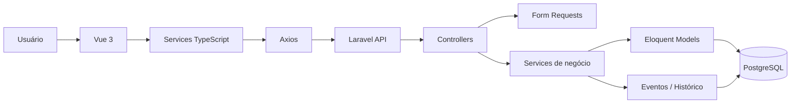
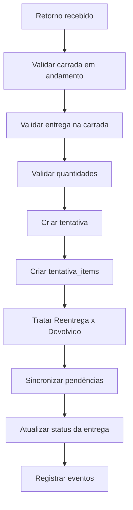
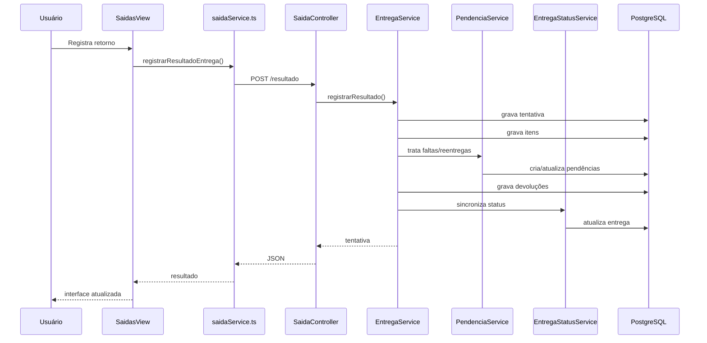
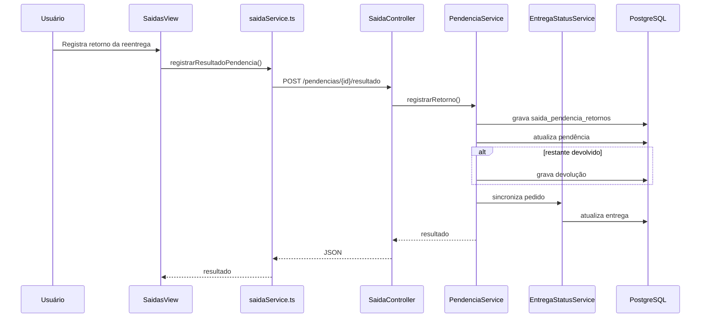

# Arquitetura do Sistema

## 1. Objetivo

Este documento descreve a arquitetura técnica atual do Sistema de Gerenciamento de Entregas.

O objetivo é deixar claro:

- quais tecnologias são utilizadas;
- como backend, frontend e banco de dados se relacionam;
- qual responsabilidade pertence a cada camada;
- onde devem ficar regras de negócio;
- como o fluxo de uma operação percorre o sistema;
- quais decisões arquiteturais devem ser preservadas nas próximas evoluções.

---

# 2. Stack atual

## Backend

- PHP 8.2+
- Laravel 12
- Laravel Sanctum
- Eloquent ORM
- Form Requests
- API Resources
- Services
- PostgreSQL

## Frontend

- Vue 3
- TypeScript
- Vite
- Pinia
- Vue Router
- Axios

## Infraestrutura

- Docker
- PostgreSQL 17
- ambiente local Linux

## Portas utilizadas no ambiente atual

```text
Frontend:   http://localhost:5173
Backend:    http://127.0.0.1:8001
PostgreSQL: 127.0.0.1:5433
```

---

# 3. Visão geral da arquitetura



A aplicação segue uma separação entre:

```text
Interface
    ↓
Comunicação HTTP
    ↓
Controller
    ↓
Regra de negócio
    ↓
Persistência
```

---

# 4. Responsabilidade de cada camada

## 4.1 Frontend

O frontend é responsável por:

- apresentar dados;
- coletar informações do operador;
- fazer validações de experiência de uso;
- chamar a API;
- atualizar a interface após operações;
- manter estado temporário da tela.

O frontend **não deve ser a fonte oficial das regras de negócio**.

Exemplo:

A tela pode impedir visualmente:

```text
entregue > carregado
```

mas o backend também deve validar essa regra.

---

## 4.2 Services do frontend

Arquivos de `services` centralizam chamadas HTTP.

Exemplo atual:

```text
frontend/src/services/saidaService.ts
```

Responsabilidades:

- definir URL;
- definir método HTTP;
- tipar request e response;
- devolver ao componente apenas os dados necessários.

Exemplo conceitual:

```ts
saidaService.registrarResultadoEntrega(...)
```

A página Vue não precisa conhecer detalhes do Axios para cada chamada.

---

## 4.3 Types do frontend

Os tipos TypeScript representam os contratos utilizados pela interface.

Exemplo:

```text
frontend/src/types/Saida.ts
```

Esse arquivo contém conceitos como:

- `Saida`;
- `SaidaEntrega`;
- `SaidaItemProgramado`;
- `ItemRetornoCarrada`;
- `DestinoNaoEntregue`;
- `MotivoDevolucao`.

### Regra arquitetural

Quando a API mudar de forma relevante, verificar também os tipos TypeScript.

---

# 5. Organização do frontend

A estrutura pode crescer por módulos.

No módulo de saídas atualmente utilizado pela aplicação:

```text
frontend/
└── src/
    ├── pages/
    │   └── Saidas/
    │       └── SaidasView.vue
    │
    ├── services/
    │   ├── api.ts
    │   └── saidaService.ts
    │
    ├── types/
    │   └── Saida.ts
    │
    ├── router/
    └── stores/
```

> A localização de outras páginas pode variar conforme a evolução do frontend, mas o princípio deve ser manter páginas, serviços e tipos separados.

---

# 6. Página `SaidasView.vue`

A tela de saídas é atualmente um dos módulos mais importantes do sistema.

Ela concentra fluxos como:

- listar carradas;
- criar carrada;
- definir rota;
- abrir carrada;
- buscar entregas disponíveis;
- selecionar produtos;
- adicionar entrega;
- visualizar reentregas;
- adicionar pendência;
- iniciar carrada;
- registrar retorno;
- registrar retorno de reentrega;
- visualizar histórico.

### Evolução futura recomendada

Conforme a tela crescer, componentes podem ser extraídos.

Exemplo:

```text
pages/Saidas/
├── SaidasView.vue
└── components/
    ├── CarradaModal.vue
    ├── RotaCarrada.vue
    ├── EntregasDisponiveis.vue
    ├── ReentregasDisponiveis.vue
    ├── RetornoEntregaModal.vue
    ├── RetornoReentregaModal.vue
    └── HistoricoCarradaModal.vue
```

A extração deve acontecer quando melhorar legibilidade e manutenção, sem criar abstrações desnecessárias.

---

# 7. Camada HTTP do backend

## 7.1 Rotas

As rotas da API ficam em:

```text
backend/routes/api.php
```

As rotas operacionais estão protegidas por:

```php
Route::middleware('auth:sanctum')
```

Isso significa que o backend é a autoridade final para acesso às operações.

---

## 7.2 Controllers

Controllers recebem a requisição HTTP e encaminham a operação para a camada adequada.

Exemplos:

```text
SaidaController
EntregaController
ClienteController
RegiaoController
VeiculoController
EntregaHistoricoController
SaidaHistoricoController
```

### Controller deve fazer

- receber request;
- obter parâmetros da rota;
- chamar services;
- carregar relações necessárias;
- retornar Resource ou JSON.

### Controller não deve concentrar

- cálculos complexos de saldo;
- regras de reentrega;
- atualização de vários estados;
- lógica extensa de pendências.

Essas responsabilidades pertencem à camada de Services.

---

# 8. Form Requests

Form Requests centralizam validação de entrada.

Exemplos atuais:

```text
StoreSaidaRequest
AdicionarEntregaSaidaRequest
RegistrarResultadoEntregaRequest
RegistrarResultadoPendenciaRequest
```

### Exemplo

O retorno de uma entrega aceita:

```text
itens[].entrega_item_id
itens[].quantidade_entregue
itens[].destino_nao_entregue
itens[].motivo_devolucao
itens[].observacao
```

Os valores aceitos para destino são:

```text
REENTREGA
DEVOLVIDO
```

### Benefício

O Service recebe dados previamente validados e pode focar na regra de negócio.

---

# 9. Services do backend

A camada de Services contém a maior parte da lógica operacional.

Estrutura atual relevante:

```text
backend/app/Services/
├── SaidaService.php
├── EntregaService.php
├── EntregaStatusService.php
├── PendenciaService.php
└── SaidaHistoricoService.php
```

---

## 9.1 `SaidaService`

Responsável pelo ciclo operacional da carrada.

Principais responsabilidades:

- criar carrada;
- adicionar entrega;
- remover entrega;
- adicionar pendência;
- remover pendência;
- iniciar carrada;
- finalizar carrada;
- trocar veículo;
- cancelar carrada;
- calcular itens disponíveis para programação;
- controlar saldo normal;
- sincronizar estado de programação;
- registrar eventos da carrada.

### Regra importante

O `SaidaService` trabalha principalmente com:

> planejamento e estado da carrada.

---

## 9.2 `EntregaService`

Responsável pelo resultado de uma entrega normal.

Principal operação:

```text
registrarResultado()
```

Fluxo resumido:



---

## 9.3 `PendenciaService`

Responsável pelas obrigações de reentrega.

Principais responsabilidades:

- sincronizar pendências geradas por uma entrega;
- criar pendência;
- resolver pendência;
- registrar movimentações;
- registrar retorno específico de uma reentrega;
- registrar devolução originada de uma reentrega;
- decidir se o saldo volta para `ABERTA` ou termina em `RESOLVIDA`.

### Regra importante

Pendência e saldo normal são conceitos separados.

---

## 9.4 `EntregaStatusService`

Centraliza cálculos que determinam o estado logístico da entrega.

Responsabilidades atuais:

- calcular total entregue;
- calcular total devolvido;
- sincronizar status da entrega.

### Razão para existir

Após a criação de devoluções, a conclusão do pedido não pode depender somente de:

```text
quantidade entregue
```

Agora é necessário considerar:

```text
quantidade tratada =
quantidade entregue
+
quantidade devolvida
```

---

## 9.5 `SaidaHistoricoService`

Responsável por montar uma representação histórica de uma carrada.

Ele combina informações de:

- saída;
- rota;
- entregas normais;
- tentativas;
- itens;
- pendências geradas;
- reentregas;
- devoluções;
- eventos.

### Regra importante

Carradas contendo somente reentregas também precisam aparecer como operações reais no histórico.

---

# 10. Models

Models Eloquent representam entidades persistidas.

Principais modelos do núcleo:

```text
Entrega
EntregaItem

Saida
SaidaEntrega
SaidaEntregaItem

TentativaEntrega
TentativaItem

Pendencia
PendenciaMovimentacao

Devolucao
SaidaPendenciaRetorno

SaidaEvento
EntregaEvento
```

### Model deve conter

- tabela;
- fillable;
- casts;
- relacionamentos;
- comportamentos simples diretamente relacionados à entidade.

### Model não deve virar

um grande Service escondido.

Regras que coordenam várias entidades devem continuar nos Services.

---

# 11. Resources

Resources padronizam a saída HTTP.

Exemplo:

```text
SaidaResource
```

Benefícios:

- evita retornar Model bruto;
- controla campos expostos;
- normaliza enums;
- organiza relações;
- mantém formato estável para o frontend.

Fluxo:

```text
Model
  ↓
Resource
  ↓
JSON
  ↓
TypeScript
```

---

# 12. Banco PostgreSQL

O PostgreSQL é a fonte oficial do estado persistido.

O banco contém:

- dados operacionais atuais;
- histórico;
- relacionamentos;
- snapshots;
- movimentações.

### Tipos utilizados

O projeto utiliza recursos como:

- foreign keys;
- numeric com 3 casas;
- enums;
- JSONB;
- timestamps;
- índices;
- constraints de unicidade.

---

# 13. Uso de JSONB

O principal uso atual é:

```text
saidas.rota
```

Exemplo:

```json
[
  {
    "regiao_id": 1,
    "nome": "Gameleira"
  },
  {
    "regiao_id": 2,
    "nome": "Serra de São João"
  }
]
```

### Por que JSONB neste caso

A rota:

- é ordenada;
- funciona como snapshot histórico;
- permite parada livre;
- não precisa ser normalizada como uma entidade operacional complexa neste momento.

---

# 14. Transações

Operações que alteram várias tabelas devem utilizar transação.

Exemplos:

- registrar retorno;
- gerar pendência;
- registrar devolução;
- adicionar ou remover reentrega;
- finalizar operação de pendência.

Modelo conceitual:

```php
DB::transaction(function () {
    // alterações relacionadas
});
```

### Objetivo

Ou a operação inteira acontece, ou nenhuma parte fica gravada.

---

# 15. Histórico e eventos

O sistema possui duas formas complementares de histórico.

## Estado persistido

Exemplos:

- tentativa;
- pendência;
- devolução;
- retorno de reentrega.

Esses registros possuem valor operacional próprio.

## Eventos

Exemplos:

- `SAIDA_CRIADA`;
- `ENTREGA_ADICIONADA`;
- `PENDENCIA_ADICIONADA`;
- `SAIDA_INICIADA`;
- `RESULTADO_ENTREGA_REGISTRADO`.

Eventos ajudam a explicar a sequência da operação.

### Regra

Evento não deve substituir uma entidade necessária para cálculo.

Por exemplo:

A devolução precisa existir em `devolucoes`, não somente em um JSON de evento.

---

# 16. Fluxo técnico de uma entrega normal



---

# 17. Fluxo técnico de uma reentrega



---

# 18. Autenticação

A API operacional é protegida por Laravel Sanctum.

Arquitetura:

```text
Vue
  ↓
Axios com cookies/credenciais
  ↓
Sanctum
  ↓
auth:sanctum
  ↓
Controller
```

O usuário autenticado pode ser utilizado para registrar:

- quem criou a carrada;
- quem registrou movimentação;
- quem registrou devolução;
- quem registrou retorno.

---

# 19. Separação das regras críticas

As seguintes regras devem existir no backend, mesmo que o frontend também faça validações:

```text
entregue <= carregado

programado <= saldo disponível

pendência não pode estar em duas carradas

carrada só inicia com conteúdo

carrada só finaliza com todos os retornos

DEVOLVIDO não gera reentrega

REENTREGA não volta como saldo normal
```

O frontend melhora UX.

O backend protege a integridade.

---

# 20. Organização recomendada do backend

Estrutura de referência:

```text
backend/
├── app/
│   ├── Enums/
│   │
│   ├── Http/
│   │   ├── Controllers/
│   │   ├── Requests/
│   │   │   ├── Entregas/
│   │   │   ├── Pendencias/
│   │   │   └── Saidas/
│   │   └── Resources/
│   │
│   ├── Models/
│   │
│   └── Services/
│
├── database/
│   ├── migrations/
│   ├── factories/
│   └── seeders/
│
├── routes/
│   └── api.php
│
└── tests/
    └── Feature/
```

---

# 21. Testes

As regras mais importantes devem possuir testes de integração/Feature.

Exemplo de suíte existente:

```text
tests/Feature/SaidaTest.php
```

Cenários relevantes:

- criar carrada;
- adicionar entrega;
- dividir produto entre carradas;
- impedir quantidade acima do saldo;
- iniciar;
- registrar retorno;
- gerar pendência somente do que saiu;
- devolução não gerar pendência;
- reentrega;
- reentrega parcial;
- finalizar;
- cancelar.

---

# 22. Convenções arquiteturais

## 22.1 Regra de negócio

Preferir:

```text
Service
```

e não duplicar lógica em:

```text
Controller
Vue
Resource
```

---

## 22.2 Validação HTTP

Preferir:

```text
FormRequest
```

---

## 22.3 Saída HTTP

Preferir:

```text
Resource
```

ou resposta JSON explícita quando o endpoint for operacional e específico.

---

## 22.4 Estado histórico

Não recalcular fatos históricos de forma destrutiva.

Utilizar:

- tabelas históricas;
- snapshots;
- eventos;
- movimentações.

---

## 22.5 Nomes do domínio

Utilizar a linguagem da operação.

Exemplos:

```text
Carrada
Reentrega
Devolução
Pendência
Carregado
Entregue
```

Isso aproxima código, documentação e uso real do sistema.

---

# 23. Princípio arquitetural central

O sistema deve manter uma única fonte de verdade para cada tipo de informação.

Exemplo:

```text
Entrega realizada
→ tentativa_items

Obrigação de reentrega
→ pendencias

Retorno de reentrega
→ saida_pendencia_retornos

Quantidade encerrada por devolução
→ devolucoes

Histórico temporal da carrada
→ saida_eventos
```

Evitar representar a mesma informação de maneiras concorrentes que possam produzir resultados diferentes.

---

# 24. Evolução futura

A arquitetura atual permite evoluir para:

- OCR;
- importação de documentos;
- dashboard;
- relatórios;
- ocorrências operacionais;
- cálculo de custos;
- mobile;
- integrações externas.

Ao adicionar novos módulos, preservar o fluxo:

```text
Frontend
   ↓
Service HTTP
   ↓
Controller
   ↓
Request
   ↓
Service de negócio
   ↓
Models / Banco
   ↓
Resource / JSON
```
