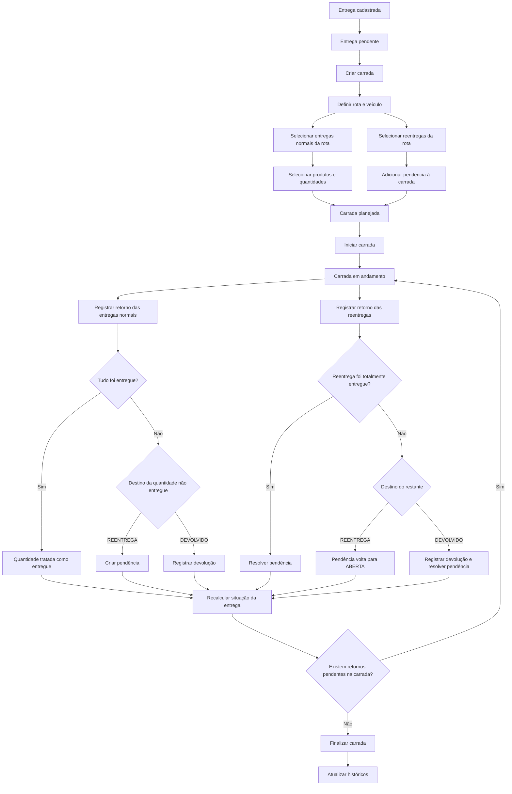
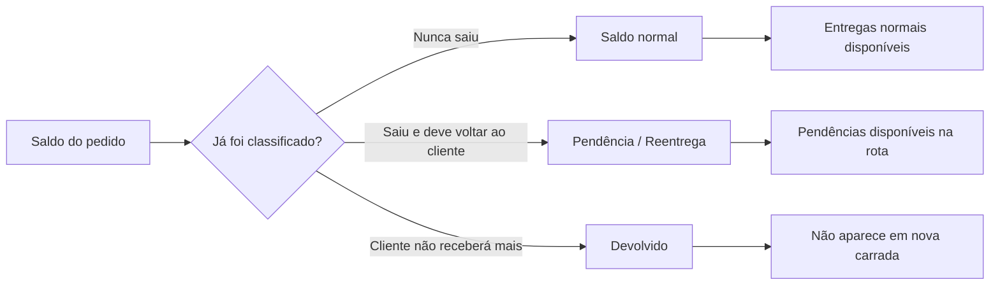
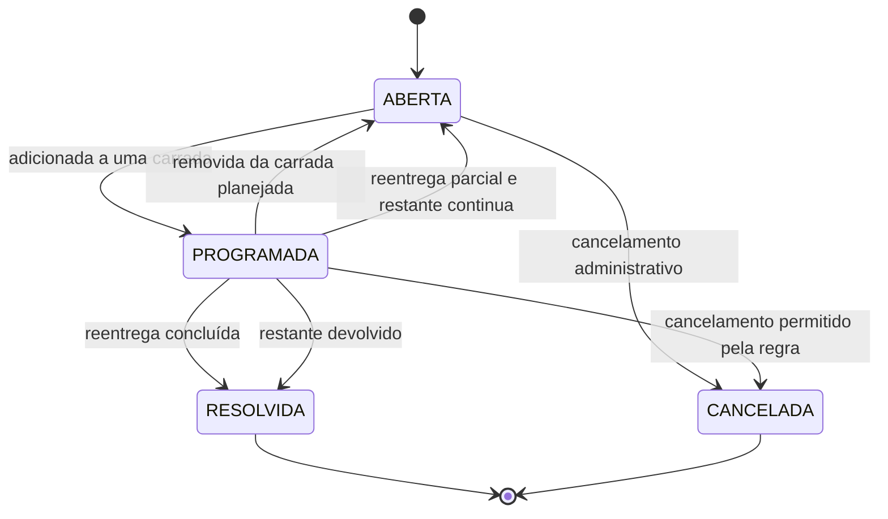
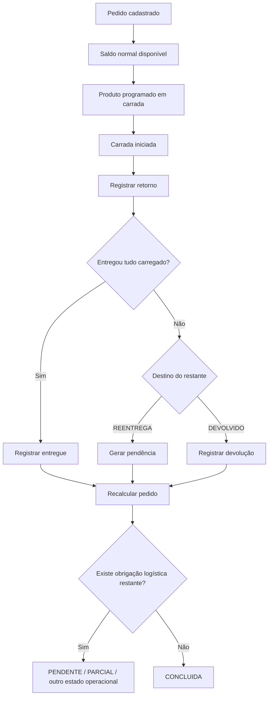
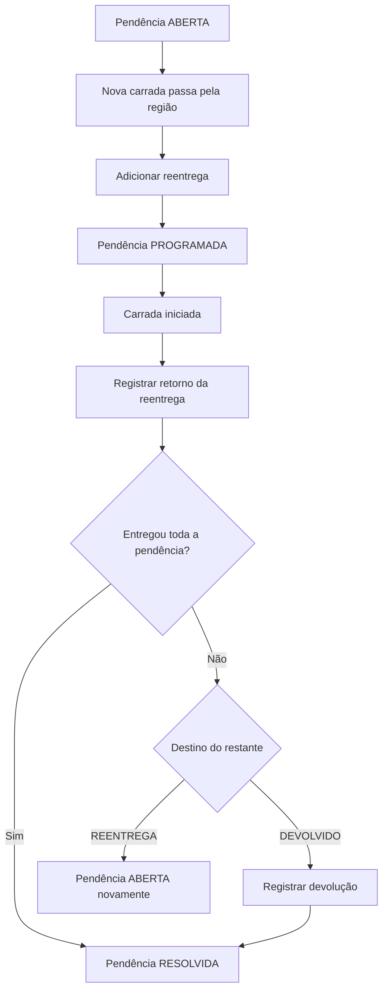

# Fluxo do Sistema

## 1. Objetivo

Este documento descreve o fluxo operacional atual do Sistema de Gerenciamento de Entregas.

O objetivo é registrar como o sistema deve se comportar desde o cadastro de uma entrega até sua conclusão logística, incluindo:

- formação de carradas;
- definição de rota;
- programação parcial de produtos;
- retorno da entrega;
- pendências;
- reentregas;
- devoluções;
- histórico da entrega;
- histórico da carrada.

---

## 2. Visão geral do fluxo



---

## 3. Cadastro da entrega

Uma entrega representa um pedido que precisa ser atendido logisticamente.

O cadastro pode conter:

- número do pedido;
- cliente;
- região;
- endereço;
- referência;
- prioridade;
- observação;
- produtos;
- quantidade solicitada de cada produto.

### Exemplo

Pedido `#89567`:

| Produto | Código | Quantidade |
|---|---:|---:|
| Argamassa AC3 | 148 | 50 UN |

Após o cadastro, a entrega começa disponível para planejamento, de acordo com seu status e saldo.

---

## 4. Formação da carrada

Uma carrada representa uma saída física da loja.

Na criação da carrada são definidos, quando aplicável:

- data;
- região principal;
- veículo;
- rota;
- observação.

### 4.1 Rota

A rota é uma lista ordenada de paradas.

Exemplo:

1. Gameleira;
2. Serra de São João;
3. Malhada Redonda;
4. Banco de Areia.

A ordem da rota deve ser preservada no histórico.

Uma parada pode ser:

- uma região cadastrada, com `regiao_id`;
- uma parada de texto livre.

Somente regiões cadastradas podem ser utilizadas para localizar automaticamente entregas e pendências.

---

## 5. O que aparece durante o planejamento

Ao abrir uma carrada `PLANEJADA`, o sistema deve separar dois grupos.

### 5.1 Entregas normais disponíveis

São quantidades do pedido que ainda podem ser enviadas normalmente.

O sistema deve considerar as regiões cadastradas na rota e mostrar apenas entregas que possuam saldo normal disponível.

### 5.2 Pendências disponíveis na rota

São quantidades que já saíram em uma tentativa anterior, não foram entregues e continuam aguardando reentrega.

Essas quantidades não podem voltar a aparecer como saldo normal.



---

## 6. Programação parcial de produtos

Uma entrega não precisa ser enviada inteira em uma única carrada.

### Exemplo

Pedido:

- 100 blocos.

Planejamento:

- carrada 1: 55;
- quantidade ainda não enviada: 45.

O sistema deve impedir que a quantidade programada seja superior ao saldo normal disponível.

### Conceito

```text
quantidade programada <= quantidade disponível
```

---

## 7. Início da carrada

Uma carrada só pode ser iniciada quando possuir pelo menos:

- uma entrega normal; ou
- uma reentrega.

Ao iniciar:

```text
PLANEJADA → EM_ANDAMENTO
```

A partir desse momento, o sistema passa a aguardar o retorno das operações realizadas naquela viagem.

---

## 8. Retorno de uma entrega normal

O retorno é registrado por entrega e por produto.

A tela deve mostrar:

| Produto | Carregado | Entregue | Faltou | Destino |
|---|---:|---:|---:|---|
| Argamassa AC3 | 50 | 45 | 5 | Reentrega |
| Cimento | 20 | 18 | 2 | Devolvido |
| Torneira | 1 | 1 | 0 | — |

O campo **Destino** só é necessário quando:

```text
quantidade_entregue < quantidade_carregada
```

---

## 9. Destino da quantidade não entregue

Para cada produto não entregue completamente, o operador precisa informar o que aconteceu com a diferença.

Existem dois destinos.

### 9.1 REENTREGA

Usado quando o cliente ainda deve receber o produto.

Resultado:

- cria ou mantém uma obrigação logística;
- gera pendência;
- a quantidade poderá aparecer em outra carrada;
- a entrega não pode ser considerada totalmente concluída enquanto houver saldo a tratar.

### 9.2 DEVOLVIDO

Usado quando aquela quantidade não deve mais ser entregue ao cliente.

Exemplos de motivo:

- cliente recusou;
- cliente desistiu;
- produto incorreto;
- produto avariado;
- quantidade excedente;
- outro.

Resultado:

- registra devolução;
- não cria pendência;
- não aparece em uma nova carrada;
- a quantidade passa a ser considerada encerrada logisticamente.

---

## 10. Regra de quantidade tratada

Para fins logísticos:

```text
quantidade tratada = quantidade entregue + quantidade devolvida
```

### Exemplo A — pedido concluído com devolução

```text
Comprado:   50
Entregue:   45
Devolvido:   5
----------------
Tratado:    50
```

Não existe mais obrigação de entrega.

### Exemplo B — pedido parcial com reentrega

```text
Comprado:   50
Entregue:   45
Pendência:   5
```

Ainda existem 5 unidades que o cliente deve receber.

---

## 11. Criação da pendência

Uma pendência deve nascer somente quando uma quantidade:

1. saiu fisicamente da loja;
2. não foi entregue;
3. ainda deve ser entregue ao cliente.

### Exemplo

```text
Carregado: 55
Entregue:  50
Faltou:     5
Destino: REENTREGA
```

Resultado:

```text
Pendência criada: 5
Status: ABERTA
```

---

## 12. Planejamento da reentrega

Quando uma nova carrada passa pela região da pendência, ela deve aparecer em:

> Pendências disponíveis na rota

Exemplo:

```text
Pedido #89567
Cliente: Doquinha de cicero
Região: Serra de São João

Argamassa AC3
Cód. 148

Pendente: 5 UN
```

Ao adicionar à carrada:

```text
ABERTA → PROGRAMADA
```

A mesma pendência não pode ser programada simultaneamente em duas carradas.

---

## 13. Retorno de uma reentrega

Uma reentrega também precisa de retorno próprio.

### 13.1 Reentrega completa

```text
Programado: 5
Entregue:   5
```

Resultado:

```text
Pendência → RESOLVIDA
```

### 13.2 Reentrega parcial que continuará

```text
Programado: 5
Entregue:   3
Restante:   2
Destino: REENTREGA
```

Resultado:

```text
3 resolvidos
2 continuam pendentes
Pendência → ABERTA
```

### 13.3 Reentrega parcial com devolução

```text
Programado: 5
Entregue:   3
Restante:   2
Destino: DEVOLVIDO
```

Resultado:

```text
3 entregues
2 devolvidos
Pendência → RESOLVIDA
```

---

## 14. Estados da pendência



---

## 15. Finalização da carrada

A carrada não deve ser finalizada enquanto existir operação obrigatória sem retorno registrado.

Devem estar tratados:

- retornos das entregas normais;
- retornos das reentregas.

Quando tudo estiver registrado:

```text
EM_ANDAMENTO → FINALIZADA
```

---

## 16. Histórico da entrega

O histórico da entrega deve permitir entender a situação de cada produto.

Informações relevantes:

- comprado;
- entregue;
- devolvido;
- saldo restante;
- pendência;
- em carrada;
- ainda não enviado;
- tentativas realizadas.

### Exemplo

```text
Argamassa AC3
Cód. 148

Comprado:        50
Entregue:        45
Devolvido:        0
Saldo restante:   5
Pendência:         5
Em carrada:        0
Ainda não enviado: 0
```

---

## 17. Histórico da carrada

O histórico da carrada deve representar tudo que aconteceu naquela viagem.

Deve possuir seções distintas para:

- resumo;
- rota;
- entregas normais;
- reentregas;
- devoluções;
- pendências geradas;
- linha do tempo.

### Regra importante

Uma carrada que contém apenas reentregas **não está vazia**.

Exemplo incorreto:

> Esta carrada não possui entregas.

Exemplo correto:

```text
Entregas normais: 0
Reentregas: 1
Atendimentos: 1
```

E abaixo:

```text
Reentregas desta carrada

Pedido #89567
Doquinha de cicero
Argamassa AC3
5 UN
```

---

## 18. Linha do tempo da carrada

Eventos relevantes devem ser registrados para rastreabilidade.

Exemplos:

```text
Carrada criada
Entrega adicionada
Entrega atualizada
Entrega removida
Pendência adicionada
Pendência removida
Carrada iniciada
Resultado da entrega registrado
Resultado da reentrega registrado
Veículo trocado
Carrada finalizada
Carrada cancelada
```

A linha do tempo serve para explicar como a carrada chegou ao estado atual.

---

## 19. Fluxo resumido de uma entrega



---

## 20. Fluxo resumido de uma pendência



---

## 21. Princípio central do sistema

Uma mesma unidade física de produto não pode estar simultaneamente em duas classificações logísticas conflitantes.

O sistema deve sempre distinguir:

```text
ENTREGUE
DEVOLVIDO
PENDENTE / REENTREGA
EM CARRADA
AINDA NÃO ENVIADO
```

Essa separação é essencial para evitar:

- dupla programação;
- pendências duplicadas;
- saldo incorreto;
- reentregas indevidas;
- histórico inconsistente.

---

## 22. Fluxos futuros fora do núcleo atual

Os seguintes fluxos fazem parte da evolução do produto, mas não são o foco deste documento:

- OCR de notas;
- importação automática de documentos;
- otimização automática de rota;
- cálculo automático de capacidade de veículo;
- cálculo de custo de reentrega;
- dashboards gerenciais;
- relatórios consolidados;
- integração com sistemas externos.
