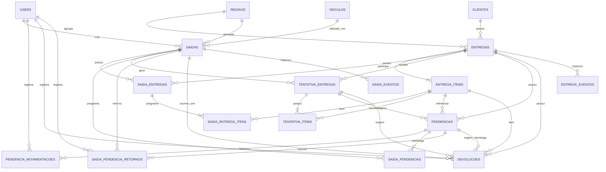
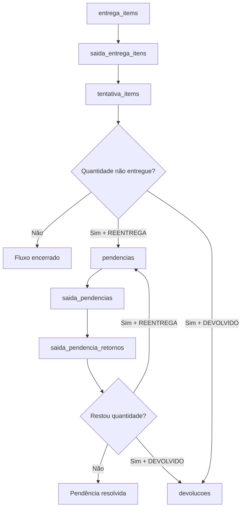

# Modelo de Entidades

## 1. Objetivo

Este documento descreve o modelo de dados atual do Sistema de Gerenciamento de Entregas.

O foco é registrar:

- principais entidades;
- responsabilidade de cada tabela;
- relacionamentos;
- regras estruturais importantes;
- entidades de histórico;
- entidades utilizadas em pendências, reentregas e devoluções.

Este documento deve ser atualizado sempre que uma alteração estrutural relevante for feita no banco de dados.

---

# 2. Visão geral do domínio

O núcleo do sistema pode ser dividido em seis grupos:

1. **Cadastros**
   - clientes;
   - regiões;
   - funcionários;
   - veículos;
   - usuários.

2. **Entrega**
   - entregas;
   - entrega_items.

3. **Carrada**
   - saidas;
   - saida_entregas;
   - saida_entrega_itens;
   - saida_equipes;
   - saida_eventos.

4. **Retorno**
   - tentativa_entregas;
   - tentativa_items.

5. **Pendências e reentregas**
   - pendencias;
   - pendencia_movimentacoes;
   - saida_pendencias;
   - saida_pendencia_retornos.

6. **Devoluções e histórico**
   - devolucoes;
   - entrega_eventos;
   - ocorrencias_operacionais;
   - documento_importados.

---

# 3. Diagrama geral



---

# 4. Cadastros

## 4.1 `users`

Representa os usuários autenticados do sistema.

É utilizada para identificar quem executou operações importantes.

Relacionamentos relevantes:

- cria carradas;
- registra movimentações de pendência;
- registra devoluções;
- registra retornos de reentregas;
- pode aparecer em eventos de histórico.

---

## 4.2 `clientes`

Representa o cadastro reutilizável de clientes.

Uma entrega também mantém dados operacionais próprios do cliente para permitir que o histórico continue compreensível mesmo que o cadastro seja alterado futuramente.

Relacionamento principal:

```text
clientes 1 ─── N entregas
```

---

## 4.3 `regiaos`

> Nome físico atual da tabela: `regiaos`.

Representa regiões utilizadas para organização das entregas e formação das rotas.

É utilizada principalmente em:

- entrega;
- região principal da carrada;
- busca de entregas disponíveis;
- busca de pendências disponíveis na rota.

Relacionamentos:

```text
regiaos 1 ─── N entregas
regiaos 1 ─── N saidas
```

A rota completa da carrada não depende somente desta FK, pois também é armazenada como snapshot ordenado em `saidas.rota`.

---

## 4.4 `funcionarios`

Representa funcionários que podem participar da operação logística.

É utilizada em conjunto com `saida_equipes`.

---

## 4.5 `veiculos`

Representa os veículos disponíveis para as carradas.

Campos relevantes conhecidos:

- `id`;
- `nome`;
- `placa`;
- `tipo`;
- `status`;
- `observacao`;
- `ativo`.

Estados utilizados atualmente:

- `DISPONIVEL`;
- `INDISPONIVEL`;
- `MANUTENCAO`.

Relacionamento:

```text
veiculos 1 ─── N saidas
```

---

# 5. Entrega

## 5.1 `entregas`

É a entidade principal do pedido logístico.

Representa aquilo que precisa chegar até o cliente.

Informações relevantes:

- número do pedido;
- cliente;
- região;
- endereço;
- prioridade;
- status;
- observação;
- dados auxiliares do cliente.

Estados atuais:

- `PENDENTE`;
- `PROGRAMADA`;
- `EM_SAIDA`;
- `PARCIAL`;
- `CONCLUIDA`;
- `NAO_ENTREGUE`;
- `CANCELADA`.

Relacionamentos principais:

```text
entregas 1 ─── N entrega_items
entregas 1 ─── N saida_entregas
entregas 1 ─── N tentativa_entregas
entregas 1 ─── N pendencias
entregas 1 ─── N devolucoes
entregas 1 ─── N entrega_eventos
```

### Regra importante

Uma entrega pode participar de várias carradas.

Isso permite programação parcial.

Exemplo:

```text
Pedido: 100 blocos

Carrada A: 55
Carrada B: 45
```

---

## 5.2 `entrega_items`

Representa cada produto solicitado em uma entrega.

Estrutura atual conhecida:

| Campo | Tipo / característica |
|---|---|
| `id` | bigint |
| `entrega_id` | FK para `entregas` |
| `codigo_produto` | varchar(80), nullable |
| `descricao_produto` | varchar(255) |
| `unidade` | varchar(20), nullable |
| `quantidade_solicitada` | numeric(12,3) |
| `observacao` | text, nullable |
| `created_at` | timestamp |
| `updated_at` | timestamp |

Relacionamento:

```text
entregas 1 ─── N entrega_items
```

### Observação importante

O nome correto da coluna no banco é:

```text
descricao_produto
```

Não utilizar `descricao`.

---

# 6. Carrada

## 6.1 `saidas`

Representa uma carrada.

Cada registro corresponde a uma saída física planejada ou realizada.

Campos conceitualmente importantes:

- `id`;
- `regiao_principal_id`;
- `veiculo_id`;
- `data_saida`;
- `status`;
- `rota`;
- `observacao`;
- `criado_por`.

Estados:

- `PLANEJADA`;
- `EM_ANDAMENTO`;
- `FINALIZADA`;
- `CANCELADA`.

### Campo `rota`

A rota é armazenada como JSONB.

Exemplo:

```json
[
  {
    "regiao_id": 1,
    "nome": "Gameleira"
  },
  {
    "regiao_id": 2,
    "nome": "Serra de São João"
  },
  {
    "regiao_id": null,
    "nome": "Banco de Areia"
  }
]
```

Esse campo funciona como um snapshot ordenado.

Vantagens:

- preserva a ordem;
- preserva o nome histórico;
- permite parada livre;
- evita alterar uma carrada antiga quando o cadastro de região mudar.

---

## 6.2 `saida_entregas`

Tabela associativa entre carradas e entregas normais.

Relacionamento:

```text
saidas N ─── N entregas
```

Além da associação, guarda informações da participação daquela entrega naquela carrada, como ordem operacional.

Estrutura lógica:

```text
saida
  └── saida_entrega
        └── produtos programados
```

---

## 6.3 `saida_entrega_itens`

Define quais produtos e quantidades de uma entrega foram programados para uma carrada específica.

Campos atuais conhecidos:

- `id`;
- `saida_entrega_id`;
- `entrega_item_id`;
- `quantidade_programada`;
- timestamps.

Existe unicidade para:

```text
(saida_entrega_id, entrega_item_id)
```

### Exemplo

Pedido:

```text
100 blocos
```

Carrada:

```text
55 blocos
```

`saida_entrega_itens.quantidade_programada`:

```text
55
```

Os outros 45 continuam fora desta carrada.

---

## 6.4 `saida_equipes`

Relaciona funcionários à carrada.

Serve para registrar quem participou da viagem.

Pode representar, por exemplo:

- motorista;
- ajudante;
- carregador;
- outros integrantes.

---

## 6.5 `saida_eventos`

Registra a linha do tempo da carrada.

Campos atuais conhecidos:

- `id`;
- `saida_id`;
- `usuario_id`;
- `tipo_evento`;
- `descricao`;
- `dados` JSONB;
- `created_at`.

Eventos atualmente utilizados ou previstos no fluxo:

- `SAIDA_CRIADA`;
- `ENTREGA_ADICIONADA`;
- `ENTREGA_ATUALIZADA`;
- `ENTREGA_REMOVIDA`;
- `PENDENCIA_ADICIONADA`;
- `PENDENCIA_REMOVIDA`;
- `SAIDA_INICIADA`;
- `SAIDA_FINALIZADA`;
- `VEICULO_TROCADO`;
- `SAIDA_CANCELADA`;
- `RESULTADO_ENTREGA_REGISTRADO`;
- retorno de reentrega.

### Objetivo

O evento não substitui os dados operacionais principais.

Ele serve para explicar:

> o que aconteceu, quando aconteceu e quem executou a operação.

---

# 7. Tentativas de entrega

## 7.1 `tentativa_entregas`

Representa o resultado de uma entrega normal dentro de uma carrada.

Uma tentativa pertence a:

- uma entrega;
- uma carrada.

Armazena informações como:

- resultado;
- motivo da não entrega;
- observação;
- data/hora.

Resultados utilizados:

- `COMPLETA`;
- `PARCIAL`;
- `NAO_ENTREGUE`.

### Regra

Uma entrega não pode ter duas tentativas para a mesma carrada.

---

## 7.2 `tentativa_items`

Representa o resultado por produto dentro de uma tentativa.

Campos conceituais:

- `tentativa_id`;
- `entrega_item_id`;
- `quantidade_entregue`;
- observação.

### Exemplo

Programado:

```text
50 argamassas
```

Retorno:

```text
45 entregues
```

A tentativa registra:

```text
quantidade_entregue = 45
```

Os 5 restantes serão tratados separadamente como:

- reentrega; ou
- devolução.

---

# 8. Pendências

## 8.1 `pendencias`

Representa uma obrigação de reentrega.

Estrutura atual:

| Campo | Regra |
|---|---|
| `id` | PK |
| `entrega_id` | FK para `entregas` |
| `entrega_item_id` | FK para `entrega_items` |
| `tentativa_origem_id` | FK nullable para `tentativa_entregas` |
| `quantidade_original` | numeric(12,3) |
| `quantidade_resolvida` | numeric(12,3), default 0 |
| `motivo` | varchar(100), nullable |
| `status` | enum |
| `observacao` | text, nullable |
| `data_abertura` | timestamptz |
| `data_resolucao` | timestamptz, nullable |
| timestamps | Laravel |

Estados:

- `ABERTA`;
- `PROGRAMADA`;
- `RESOLVIDA`;
- `CANCELADA`.

### Saldo da pendência

```text
saldo pendente =
quantidade_original - quantidade_resolvida
```

### Exemplo

```text
quantidade_original: 5
quantidade_resolvida: 3
saldo: 2
```

---

## 8.2 `pendencia_movimentacoes`

Mantém o histórico de alterações da pendência.

Estrutura atual:

| Campo | Descrição |
|---|---|
| `id` | PK |
| `pendencia_id` | FK |
| `tentativa_id` | FK nullable |
| `tipo` | tipo da movimentação |
| `quantidade` | numeric(12,3), nullable |
| `observacao` | text, nullable |
| `usuario_id` | usuário responsável |
| timestamps | Laravel |

Tipos atuais:

- `CRIACAO`;
- `PROGRAMACAO`;
- `ENTREGA_PARCIAL`;
- `RESOLUCAO`;
- `AJUSTE`;
- `CANCELAMENTO`.

### Objetivo

Enquanto `pendencias` representa o estado atual, `pendencia_movimentacoes` explica como esse estado foi alcançado.

---

# 9. Reentrega

## 9.1 `saida_pendencias`

Tabela associativa entre carrada e pendência.

Representa:

> esta pendência foi programada para esta carrada.

Relacionamento:

```text
saidas N ─── N pendencias
```

### Fluxo

```text
Pendência ABERTA
      ↓
adicionar à carrada
      ↓
saida_pendencias
      ↓
Pendência PROGRAMADA
```

Se for removida enquanto a carrada estiver planejada:

```text
PROGRAMADA → ABERTA
```

---

## 9.2 `saida_pendencia_retornos`

Registra o resultado específico de uma reentrega.

Foi criada porque uma reentrega não deve ser confundida com uma tentativa de entrega normal.

Estrutura atual:

| Campo | Descrição |
|---|---|
| `id` | PK |
| `saida_id` | carrada |
| `pendencia_id` | pendência reentregue |
| `quantidade_programada` | saldo levado para reentrega |
| `quantidade_entregue` | quantidade entregue nessa reentrega |
| `quantidade_devolvida` | quantidade encerrada como devolvida |
| `quantidade_reentrega` | quantidade que continuará pendente |
| `destino_restante` | `REENTREGA` ou `DEVOLVIDO` |
| `motivo_devolucao` | motivo, quando houver |
| `observacao` | observação |
| `registrado_por` | FK para `users` |
| `data_hora` | data/hora do retorno |
| timestamps | Laravel |

Existe restrição única:

```text
(saida_id, pendencia_id)
```

Isso garante um único retorno da mesma pendência dentro da mesma carrada.

### Exemplo

Pendência:

```text
5 argamassas
```

Retorno:

```text
quantidade_programada: 5
quantidade_entregue: 3
quantidade_devolvida: 0
quantidade_reentrega: 2
destino_restante: REENTREGA
```

Resultado:

```text
3 resolvidas
2 continuam aguardando nova carrada
```

---

# 10. Devoluções

## 10.1 `devolucoes`

Representa uma quantidade encerrada logisticamente sem entrega ao cliente.

Estrutura atual:

| Campo | Descrição |
|---|---|
| `id` | PK |
| `entrega_id` | entrega relacionada |
| `entrega_item_id` | produto |
| `saida_id` | carrada, nullable |
| `tentativa_origem_id` | tentativa normal, nullable |
| `pendencia_id` | pendência/reentrega, nullable |
| `quantidade` | numeric(12,3) |
| `motivo` | código do motivo |
| `observacao` | texto opcional |
| `registrado_por` | FK para `users` |
| `data_hora` | timestamptz |
| timestamps | Laravel |

Motivos atualmente previstos:

- `CLIENTE_RECUSOU`;
- `CLIENTE_DESISTIU`;
- `PRODUTO_INCORRETO`;
- `PRODUTO_AVARIADO`;
- `QUANTIDADE_EXCEDENTE`;
- `OUTRO`.

### Origem da devolução

Uma devolução pode nascer de dois fluxos.

#### Entrega normal

```text
tentativa_origem_id != null
pendencia_id = null
```

#### Reentrega

```text
pendencia_id != null
```

A presença de `saida_id` permite identificar em qual carrada o produto retornou.

---

# 11. Cálculos derivados do modelo

## 11.1 Total entregue

```text
SUM(tentativa_items.quantidade_entregue)
+
quantidades efetivamente entregues nas reentregas
```

A implementação deve evitar contar a mesma quantidade duas vezes.

---

## 11.2 Total devolvido

```text
SUM(devolucoes.quantidade)
```

por `entrega_item_id`.

---

## 11.3 Saldo logístico

```text
saldo logístico =
quantidade_solicitada
- quantidade_entregue
- quantidade_devolvida
```

---

## 11.4 Saldo pendente

```text
SUM(
    pendencias.quantidade_original
    - pendencias.quantidade_resolvida
)
```

considerando pendências em estados ativos.

---

## 11.5 Saldo normal disponível

Conceitualmente:

```text
solicitado
- entregue
- devolvido
- pendências ativas
- reservas em carradas ainda sem retorno
```

---

# 12. Histórico

## 12.1 `entrega_eventos`

Registra eventos associados à entrega.

É utilizado para preservar rastreabilidade do pedido.

---

## 12.2 `saida_eventos`

Registra eventos associados à carrada.

É a fonte principal para a linha do tempo operacional da viagem.

---

## 12.3 Snapshots históricos

Algumas informações não devem depender exclusivamente do estado atual de outros cadastros.

Exemplo:

```text
saidas.rota
```

preserva a rota utilizada no momento da carrada.

Da mesma forma, eventos podem armazenar dados relevantes em JSON para registrar o contexto daquela operação.

---

# 13. Outras entidades do projeto

## 13.1 `ocorrencias_operacionais`

Prevista/utilizada para registrar situações operacionais excepcionais, como:

- veículo quebrado;
- motorista ausente;
- mudança operacional;
- problema durante a execução.

A evolução dessa entidade deve ser documentada quando o módulo de ocorrências for trabalhado no frontend.

---

## 13.2 `documento_importados`

Entidade relacionada à futura entrada de documentos externos.

O objetivo futuro é permitir trabalhar com:

- imagem;
- PDF;
- planilhas;
- OCR;
- conferência antes de gerar entrega.

Esse módulo ainda não representa o fluxo principal atual.

---

# 14. Relação entre entrega normal, pendência e devolução



---

# 15. Regras estruturais importantes

## 15.1 Não duplicar obrigação logística

Uma mesma unidade não pode estar simultaneamente:

- disponível como saldo normal;
- pendente para reentrega;
- reservada em duas carradas;
- devolvida e ainda aguardando entrega.

---

## 15.2 Pendência não substitui o item original

`pendencias` referencia `entrega_items`.

Ela não cria um novo produto.

Ela representa uma obrigação logística sobre uma quantidade daquele produto.

---

## 15.3 Devolução não altera a quantidade originalmente comprada

A quantidade solicitada deve continuar representando o pedido original.

Exemplo:

```text
Comprado: 50
Entregue: 45
Devolvido: 5
```

Não alterar:

```text
quantidade_solicitada = 50
```

A devolução é registrada separadamente.

---

## 15.4 Histórico não deve ser apagado

Ao resolver uma pendência, não excluir:

- a pendência;
- suas movimentações;
- a associação histórica com carradas;
- retornos registrados;
- devoluções.

O status deve representar seu estado atual, enquanto as demais tabelas preservam o histórico.

---

# 16. Resumo dos relacionamentos principais

```text
Cliente
  └── Entregas
       ├── Itens
       │    ├── Programações em carradas
       │    ├── Resultados por tentativa
       │    ├── Pendências
       │    └── Devoluções
       │
       ├── Tentativas
       ├── Eventos
       └── Pendências

Carrada
  ├── Entregas normais
  │    └── Itens programados
  │
  ├── Pendências / reentregas
  │    └── Retornos de reentrega
  │
  ├── Devoluções
  ├── Equipe
  ├── Veículo
  ├── Rota
  └── Eventos
```

---

# 17. Entidades que formam o núcleo atual

As entidades mais importantes para compreender o funcionamento do sistema hoje são:

```text
entregas
entrega_items

saidas
saida_entregas
saida_entrega_itens

tentativa_entregas
tentativa_items

pendencias
pendencia_movimentacoes
saida_pendencias
saida_pendencia_retornos

devolucoes

saida_eventos
entrega_eventos
```

Essas tabelas representam o ciclo:

```text
PEDIDO
  ↓
PLANEJAMENTO
  ↓
CARRADA
  ↓
RETORNO
  ↓
ENTREGUE / REENTREGA / DEVOLVIDO
  ↓
HISTÓRICO
```
